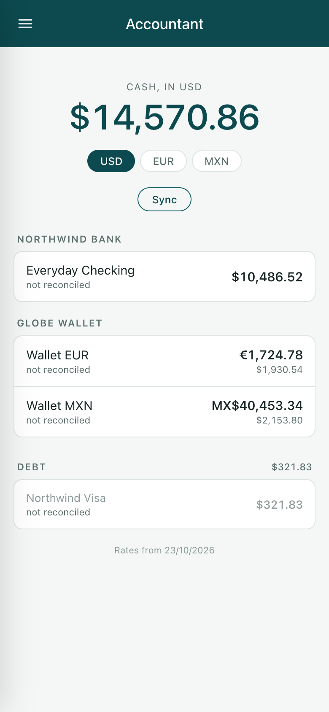
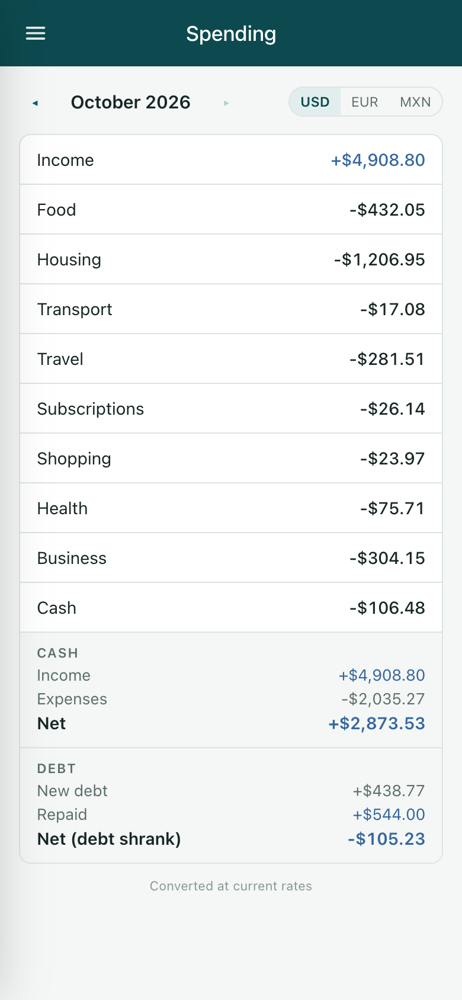
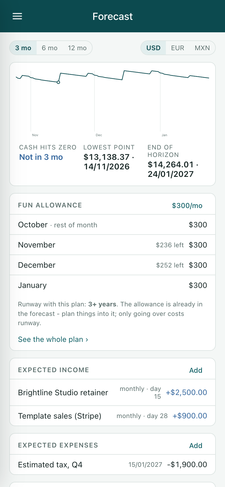
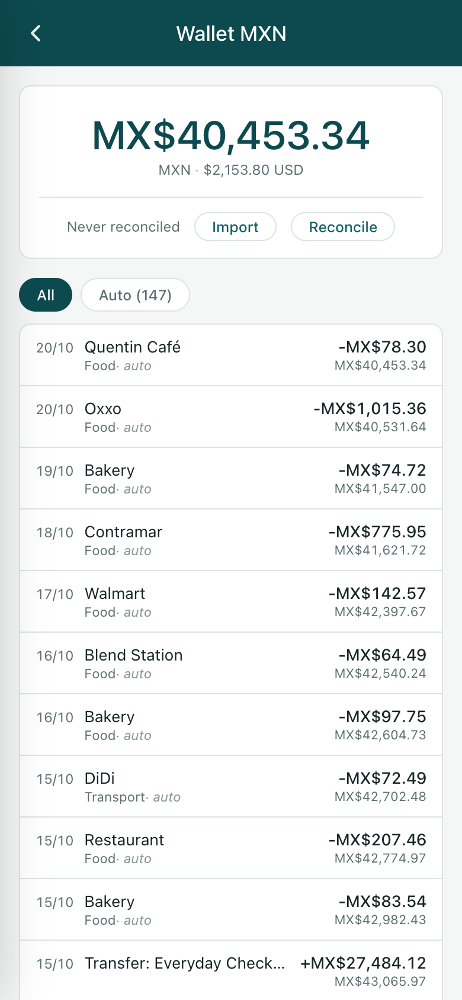

# Open Accountant

A starter kit for a personal finance app you own. It runs on your own Cloudflare account, it is meant to be shaped by an AI coding agent into the app your household actually needs, and it comes with the parts that took months to get right already working.

<p>
  
  
  
  
</p>

## Why this exists

The finance apps you can buy are built for the median household: one country, one currency, a salary that arrives on the 1st, and a bank that has an API. If that's you, use one of them. This is for everyone else.

If you freelance, your income is lumpy and comes from several places. If you live in two countries, half your spending is in a currency your bank app has never heard of. If your bank only gives you a CSV, or not even that, no aggregator will save you. And the categories that matter to you - rent paid to a person, groceries in a language you're still learning, the client who reimburses some expenses but not others - aren't the categories anyone ships.

The obvious answer now is to have an agent build you exactly the app you want. The trouble is that an agent starting from an empty repo will build you something that looks right and is quietly wrong. It will let the same transaction in twice when two sources overlap. It will make the balance drift by a cent a month because it used floats. It will let the AI overwrite your corrections. You find out three months later when the numbers don't match the bank, and by then you can't tell which of them to trust.

This repo is the part that's hard to get right, done. Your agent builds the rest.

## What's already figured out

- **Ledgers you can trust.** Each account is a ledger in its own currency, in integer cents. You reconcile it against the bank's number, and a reconciled period is frozen. If the numbers disagree, the app says by how much and from when, instead of quietly absorbing the difference.
- **One transaction, one row, whatever the source.** CSVs, bank feeds and screenshots all dedup the same way, on account, date and amount, but never on the description, because banks rename lines between downloads. Overlapping imports are safe to run as often as you like.
- **People win over the AI, permanently.** The categorizer only ever fills its own columns. Anything a person decides lives elsewhere and always takes precedence. A rerun can't undo your work.
- **Teaching beats prompting.** The categorizer learns your household from plain sentences you write ("money sent to Maria is rent"), from category descriptions, and from every correction you make. Bigger models measured no better. What limits accuracy is information, so the kit makes giving it information easy.
- **Merchants across countries and languages.** "PINGO DOCE ALVALADE", "Card transaction of Pingo Doce" and a screenshot of the same shop all resolve to one merchant. Names come out the way you'd say them, in any script, with payment processors (SQ \*, PayPal, Paddle) seen through to the business behind them.
- **Transfers aren't spending.** A top-up from checking to a wallet in another currency is recognized as a transfer even when the two legs differ by an exchange rate and a day or two. Paying off a credit card shows as debt going down, not as an expense.
- **A forecast that matches how money behaves.** Some categories are a daily burn (food), some are subscriptions that recur on their own day, some are lumps you plan for (flights, taxes). Income you expect goes in as plans. The result is a runway, not a budget to feel guilty about.
- **A fun allowance.** A monthly amount that's already in the forecast. Planning things inside it costs nothing extra; only going over moves the runway.
- **Your agents can read the books.** A read-only MCP server lets Claude, or any MCP client, answer "can we afford this?" from the same numbers the screens show. It cannot change anything.
- **Phone and desktop, both first class.** It's an installable app on your phone, and a proper desktop layout with a persistent menu on a big screen.
- **Private by default.** It runs on your Cloudflare account behind Cloudflare Access. The categorizer runs on Cloudflare's own models, so your transactions never go to a third-party AI.

## What it handles well

- **Many accounts, many currencies.** Checking, savings, cards, lines of credit and multi-currency wallets, each in its own currency, with totals in whichever currency you pick.
- **Freelancers.** Uneven income from several clients and payment platforms, business costs kept apart from personal ones, and a forecast built on what you expect rather than on a salary.
- **Nomads and people living between countries.** Spending in several currencies and languages, rent paid to people rather than companies, and travel costs as their own thing.
- **Banks with bad exports.** Any CSV, described in a config file instead of code. Plaid where it works (the US and Canada, and parts of Europe). Wise through its API. When there's nothing else, screenshots of the banking app.
- **Households.** Several people's accounts in one place, each grouped under their name.

## What it doesn't do (yet)

Budgets, tax reports, investment tracking, receipts, shared bills, alerts. Those depend on your situation, and that's exactly what your agent is for. The pattern for each is described below.

## Getting started

Give this repo to Claude Code, or any coding agent, and tell it what your situation is: which banks, which currencies, who's in the household. Then say "set this up for me". Everything below this line is written for the agent.

To look around first, the repo includes a sample household (Alex, a freelance designer who moved from Lisbon to Mexico City). See [Try it locally](#try-it-locally).

MIT licensed.

---

# For agents: setup and extension

You are setting this up for one household. Do the steps in order. Ask the owner only for things you can't find out yourself: which banks and accounts they have, their email for sign-in, and the decisions marked **Ask**. Read `CLAUDE.md` before changing code; it holds the conventions.

## Try it locally

Requires Node 22.13 or later (the tests use `node:sqlite`).

```sh
npm install
cp .dev.vars.example .dev.vars        # DEV_AUTH_EMAIL lets localhost in without Access
npm run db:local                       # schema + starter categories, local D1
npm run build && npm run dev           # http://localhost:8788
npm run sample                         # in another terminal: the sample household's accounts, rules, plan and CSVs
curl -X POST localhost:8788/api/fx-refresh -H 'content-type: application/json' -d '{}'
curl -X POST localhost:8788/api/auto-categorize -H 'content-type: application/json' -d '{"days":220,"limit":400}'
```

Run the last command until `remaining` is 0. The categorizer uses Workers AI even in local dev, so `wrangler login` first; it costs very little. `npm test` and `npm run check` should both pass before and after every change.

## 1. Cloudflare resources

```sh
npx wrangler login
npx wrangler d1 create accountant-db          # paste the database_id into wrangler.toml
npm run db:remote                             # schema + starter categories
npx wrangler pages project create accountant --production-branch main
npm run deploy
```

Workers AI needs no setup beyond the `[ai]` binding already in `wrangler.toml`. Give the Pages project a custom domain (Pages -> Custom domains) if the owner has one on Cloudflare: Access is simpler to set up on your own domain than on `*.pages.dev`.

In `wrangler.toml` `[vars]`, set `OWNER_EMAIL` (comma-separated for several people) and `HOME_CURRENCY` (the currency totals default to). **Ask** the owner both.

## 2. Cloudflare Access (sign-in)

The app has no login of its own. Cloudflare Access (Zero Trust, free for up to 50 users) sits in front of it, and the server checks Access's signed token on every request (`functions/_owner.ts`). Without Access configured, the API refuses everything.

1. In **Zero Trust -> Settings**, find the team domain, `<team>.cloudflareaccess.com` (creating the Zero Trust organization asks for it). Set `ACCESS_TEAM_DOMAIN` in `wrangler.toml`.
2. **Access -> Applications -> Add -> Self-hosted**: the app's hostname, whole site. Policy: Allow, Include -> Emails -> the owners' emails. Pick a login method (one-time PIN by email works with no setup; Google is nicer). After saving, copy the application's **AUD tag** into `ACCESS_AUD`.
3. **Access -> Service auth -> Service tokens -> Create**: name it `accountant-cli`. Put its Client ID in `ACCESS_CLIENT_ID` (wrangler.toml) and its secret in a Pages secret:
   `npx wrangler pages secret put ACCESS_CLIENT_SECRET --project-name accountant`.
   Then add a second policy to the application from step 2: Action **Service Auth**, Include -> Service Token -> `accountant-cli`. The CLI and the server's screenshot-import fan-out use this token.
4. **A second self-hosted application for the MCP endpoints**, with these paths on the same hostname: `mcp`, `oauth/token`, `oauth/register`, `.well-known`. Policy: Action **Bypass**, Include -> Everyone. These endpoints do their own OAuth. Leave `oauth/authorize` under the main application: that's where the owner approves an agent, signed in through Access.
5. `npm run deploy` again so the vars take effect.

Check: opening the site asks for Access sign-in and then shows the app. `curl https://<host>/api/accounts` without credentials gets an Access redirect. With `-H "CF-Access-Client-Id: ..." -H "CF-Access-Client-Secret: ..."` it returns JSON.

## 3. Accounts

There is no setup screen; accounts are rows you insert. **Ask** the owner for each account: a name, who it belongs to, the institution, the kind, the currency, and the date the ledger should start (usually the first day of the oldest statement you'll import).

```sql
INSERT INTO accounts (id, owner, institution, kind, currency, display_name, sort, in_spending) VALUES
  ('checking', 'Alex', 'Northwind Bank', 'checking',    'USD', 'Everyday Checking', 1, 1),
  ('visa',     'Alex', 'Northwind Bank', 'credit_card', 'USD', 'Northwind Visa',    2, 1);
INSERT INTO ledger_anchors (account_id, date, balance_cents, source) VALUES
  ('checking', '2026-01-01', 0, NULL),
  ('visa',     '2026-01-01', 0, NULL);
```

Run it with `npx wrangler d1 execute accountant-db --remote --command "..."` (or `--file`).

- `kind`: `checking`, `savings`, `wallet`, `cash`, `credit_card`, `line_of_credit`. The last two are debt: shown apart, negative when money is owed, kept out of cash.
- `in_spending`: 1 = counted in Spending and in the forecast's starting cash; 0 = ledger only (an account you track but don't plan with).
- `owner` groups the menu and dashboard by person; `institution` groups the dashboard.
- The anchor is the balance at the start of its date. Leave it at 0 if you don't know it: after importing a CSV with a balance column, `POST /api/derive-anchors` solves it from the bank's own running balances. Otherwise the owner reconciles once on the Reconcile screen.
- Wise and Plaid create their own accounts on first sync; don't insert those.

## 4. Getting transactions in

Use whichever of these the owner's banks support. All of them merge safely: importing the same days from two sources never doubles a row.

### CSV (any bank)

**Ask** the owner to download a CSV from each bank (or point you at existing ones, often in `~/Downloads`). Look at each file's header and a few rows, then describe it in `ingest.config.json` (copy `ingest.config.example.json`; the file is gitignored because it names the owner's files):

```json
{
  "api": "https://accountant.example.com",
  "formats": [{
    "name": "chase checking",
    "file": "^Chase1234_Activity.*\\.csv$",
    "account": "checking",
    "header": ["Details", "Posting Date", "Description", "Amount"],
    "date": { "column": "Posting Date", "format": "MM/DD/YYYY" },
    "description": "Description",
    "amount": "Amount",
    "balance": "Balance"
  }]
}
```

Fields (`cli/formats.ts` is the reference):

- `file`: regex on the file name. Every matching format reads the file, so one multi-currency export can feed several accounts using `only`.
- `header`: optional, the leading columns, which guards against a bank changing its layout. `skip_rows` skips a preamble above the header.
- `date.format`: `YYYY`, `YY`, `MM`, `DD` with any separators (`DD.MM.YYYY`, `YYYY/MM/DD`...). A time part is ignored.
- `description`: a column or a list of columns joined with a space.
- Amount: either `amount` (one signed column), or `debit` and `credit` (money out and money in, either one filled). Add `negate: true` when the export shows charges as positive with one amount column, which card exports often do. `decimal: ","` for `1.234,56`.
- `balance`: the running balance column, if any. It makes `derive-anchors` and the balance check work.
- `only`: `{ "column": "Status", "equals": "Posted" }` keeps matching rows. Use it to skip pending rows, or to split a file by currency.

Then `npm run ingest -- ~/Downloads --dry-run` to check the parse, and run it without `--dry-run` to push. Against production, the CLI sends the Access service token from `ACCESS_CLIENT_ID` / `ACCESS_CLIENT_SECRET` (environment or `.dev.vars`). Rows for unknown account ids are dropped and reported, so create the accounts first. Rows dated inside a reconciled period are refused and listed, never silently inserted.

`sample-data/` has three real-looking examples: US-style checking with a balance, a card with debit/credit and status columns, and a two-currency wallet split with `only`.

### Wise

Each person with Wise creates a personal API token (Wise -> Settings -> API tokens). Store them comma-separated:
`npx wrangler pages secret put WISE_API_KEYS --project-name accountant`.
The Sync screen (or `POST /api/wise-sync`) then pulls every balance of every profile. Each balance becomes an account, `external_ref = 'wise:<profile>:<CUR>'`, with its opening balance worked out so it matches Wise. The default window starts on January 1 of this year; pass `{"since":"YYYY-MM-DD"}` for more (at most 469 days).

Wise doesn't let personal tokens read statements for some profiles (in the EU and UK it can require strong customer authentication). If the sync fails with a 403, use the per-balance statement CSV instead (Wise -> a balance -> Statements -> CSV). It has signed `Amount` and `Running Balance` columns and imports like any other CSV.

### Plaid (US, Canada, UK, parts of Europe)

Plaid connects to most banks in the US and Canada, and many in the UK and Europe. It's the best option where it works, because new transactions arrive without anyone downloading anything. The owner needs their own Plaid developer account; walk them through it:

1. Sign up at dashboard.plaid.com (an individual developer account is fine). The **Sandbox** keys work immediately with fake banks: use them to test (`PLAID_ENV=sandbox`, user `user_good`, password `pass_good`).
2. To link real banks, request **Production** access in the dashboard. Plaid has offered a free tier with a limited number of connected banks, which covers a household; check the current terms with the owner. Some large US banks (Chase, Bank of America, Wells Fargo...) log in through OAuth and need the dashboard's OAuth/institution registration completed first. The dashboard lists what's missing.
3. Put the keys in `.dev.vars` locally (`PLAID_CLIENT_ID`, `PLAID_SECRET`, `PLAID_ENV`, `PLAID_COUNTRY_CODES` such as `US` or `US,CA`) and run `npm run plaid:link` on a desktop. It opens Plaid Link on localhost; the owner logs in to their bank, and the script prints an access token and the bank's accounts.
4. Store the credentials as Pages secrets: `PLAID_CLIENT_ID`, `PLAID_SECRET`, and `PLAID_ACCESS_TOKENS` (comma-separated, one per linked bank; append for each new bank). Set `PLAID_ENV` and `PLAID_COUNTRY_CODES` in `wrangler.toml`. Deploy.
5. Sync. New Plaid accounts are created automatically. If the owner already imported CSVs for one of those accounts, link it before the first sync instead, so history continues in the same ledger: `UPDATE accounts SET external_ref = 'plaid:<account_id>' WHERE id = 'checking'` (the script printed the ids). Overlapping rows are matched up, not duplicated.

When a bank asks Plaid for a fresh login (every few months for some), the Sync screen shows a **Reconnect** button that runs Plaid Link in update mode from the phone. Investment and brokerage accounts are skipped.

### Screenshot import

Some banks have no export and no Plaid support, or their CSV lags by days. On any account, **Import** takes a long scrolling screenshot of the banking app's transaction list. The server reads it with a vision model in strips (in the background, so the phone can be put down), checks the rows against the running balance where the app shows one, matches them against what the ledger already has, and lets the owner pick which rows are new.

Treat this as a working code sample, not a universal reader. It was built against one bank's app. The prompt in `functions/api/import/_vision.ts` is the part to adapt to another app's layout (where dates sit, which line is the merchant, how credits are marked). Test on a real screenshot from the owner's app before relying on it.

## 5. Categories and the categorizer

`schema/seed.sql` starts the owner off with general categories, each with a description. After the first import:

1. `POST /api/auto-categorize` with `{"limit":400}` until `remaining` is 0. It pairs transfers first, then names the merchant and picks a category for each row.
2. Show the owner the Spending screen. Where it's wrong, they correct it on the transaction (for that row, or for every row with that description). Each correction is logged and shown to the model on later runs.
3. Turn what you learn into **rules** (Settings -> Rules): plain sentences about the household. Who the account holders are, what they do for work, where they live, who they pay rent to, which merchants are business costs. The seed has one placeholder rule; replace it. `sample-data/rules.sql` shows good ones.
4. Rename, merge and describe categories on the Categories screen to fit the household. The description is what the model reads. Keep `Transfers`, `Debt Repay` and `Debt Borrow`: the code uses them by name.
5. After changing rules, `{"requeue":"all"}` reclassifies every row a person hasn't decided.

Don't edit the prompt in `functions/api/_classify.ts` to fix a household-specific mistake. Write a rule or a description instead.

Each category's `flow` sets its role in the forecast: `run_rate` (averages into a daily burn), `subscriptions` (each merchant projected monthly on its usual day), `discrete` (lumpy; plan it as an expected item), `off` (ignored). Set these on the Categories screen.

## 6. Reconcile

For each account, the owner opens it, taps **Reconcile**, and enters the balance the bank shows for a date. If it matches, the period is verified and frozen. If it doesn't, the difference is recorded and shown until it's explained. Once every account is reconciled, the numbers can be trusted.

## 7. Agents (MCP)

Settings -> Agents shows the MCP URL (`https://<host>/mcp`). In Claude: Settings -> Connectors -> Add custom connector -> that URL. The owner approves it on a page behind Access. Tools: overview, transactions, spending, categories, forecast and the fun plan, all read-only. To give agents a new view, add a tool in `functions/_mcp.ts` that reuses an existing query.

## 8. Building on it

What to build is up to the owner. Some patterns that fit the design:

- **A standing report** ("where did the business costs go this quarter", a tax estimate): an endpoint in `functions/api/reports/` that computes live from `tx_resolved`, a screen that shows the numbers along with what they mean, and a row on a Reports hub. Facts the ledger can't know (a tax rate, which client reimburses what) go in the endpoint as data, with a comment.
- **A new source:** write through `ingestRows` in `functions/api/_lib.ts`, hash like `cli/formats.ts`, set `external_ref` on the accounts it feeds, and record the sync with `recordSync`.
- **A budget:** categories already carry `flow` and an optional pinned daily rate. Start there before adding tables.

Conventions that keep it trustworthy (details in `CLAUDE.md`):

- Read merchant and category through the `tx_resolved` view, never re-derive them.
- Never insert transactions except through `ingestRows`.
- Money is integer cents and dates are `YYYY-MM-DD` strings.
- Every edit happens in the one sheet component (`src/ui/Sheet.svelte`): a bottom sheet on phones, a modal on desktop.
- Test query logic against the real schema with `tests/d1.ts`, the way the existing tests do.

## Map

```
functions/
  _owner.ts            Access JWT check (who may use the app)
  _mcp.ts, _mcp-auth.ts  MCP server and its OAuth
  api/_lib.ts          ingestRows (the one write path), merchant keys, currency helpers
  api/_classify.ts     the categorizer (Workers AI)
  api/_autocat.ts      transfer pairing, then the categorizer
  api/plaid/, wise-sync.ts, import/   data sources
  api/forecast.ts, allowance/         forecast and fun allowance data
schema/schema.sql      every table, and the tx_resolved view
schema/seed.sql        starter categories
cli/                   CSV import (formats as data)
scripts/               plaid-link, sample data generator, icons
src/                   the Svelte app (views/, lib/forecast.ts is the projection math)
shared/                PWA shell: drawer, top bar, toasts, update flow
sample-data/           the sample household
```

## Known limits

- Amounts are stored in hundredths. Currencies without minor units (JPY, KRW) work but carry two unused decimals. Three-decimal currencies (KWD, BHD) round.
- Exchange rates come from frankfurter.app (European Central Bank reference rates), which covers about 30 currencies. For any other currency, add rates to `fx_rates` yourself (rate to USD).
- One household per deployment.
